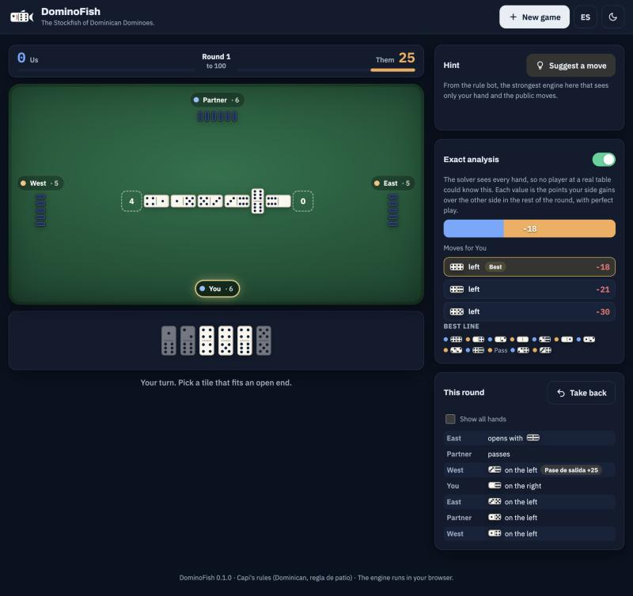

<p align="center">
  
</p>

<h1 align="center">DominoFish</h1>

<p align="center">
<b>
The Stockfish of Dominican Dominoes.
</b>
<br>
An open-source Dominican dominoes AI engine.
<br>
<sub>
Built by the creator of Capi.
</sub>
</p>

<p align="center">
<a href="#build-and-run">Build and run</a> ·
<a href="#web-board">Web board</a> ·
<a href="#what-it-does-now">What it does now</a> ·
<a href="#results">Results</a> ·
<a href="#testing">Testing</a> ·
<a href="#architecture">Architecture</a> ·
<a href="#roadmap">Roadmap</a>
</p>

DominoFish is a Rust engine for Dominican dominoes, 1v1 and 2v2 (parejas), under the rules of the game Capi. It aims to find the best move and a calibrated win probability from one player's information alone. This version holds the rules core, the information sets, four baseline bots, the match harness that measures them, an exact solver for known deals, and a web board where you play the bots in your browser. Sampling over hidden hands (M4) comes next: it will let the engine play from one seat's information.

| Area | Where it stands |
|---|---|
| **Rules** | 0 mismatches with Capi's engine over 117,456 golden-trace moves, 87 edge scenarios, 200 perft queries, and 1,000,000 fuzzed rounds per mode |
| **Speed** | About 1.4 million random 1v1 rounds and 1.3 million 2v2 rounds per second on one core (commit de3109a, load average 13.9), with 0 heap allocations in move generation, play, and undo |
| **Solver** | Exact for a known deal: 0 mismatches against naive minimax on every position checked; `dominofish bench` solves 32 full rounds in under 1.1 s on one core (Bench 6,121,081 nodes) |
| **Information** | Every engine runs as its own process and sees only its own seat's information |
| **Best baseline** | The rule bot beats the other baselines by SPRT in 16 of 18 R2 rows and gains 11.99 [10.69, 13.28] points per round on the random bot in 1v1 rounds |

## Build and run

You need Rust 1.99.1, pinned in `rust-toolchain.toml`.

```bash
cargo build --release
```

Play one game of random legal moves and print every hand, move, and score:

```bash
target/release/dominofish selfplay --mode 2v2 --seed 1
```

```text
DominoFish selfplay   mode 2v2   seed 1   target 100

Round 1
  Hands     n  [0|6] [0|4] [0|0] [5|6] [1|5] [2|6] [0|1]
            e  [5|5] [6|6] [3|6] [4|6] [2|5] [2|4] [3|3]
            s  [1|4] [1|1] [4|5] [0|3] [0|5] [2|3] [4|4]
            w  [1|3] [1|2] [3|4] [0|2] [2|2] [1|6] [3|5]
  e   opens   [6|6]
  s   passes
  w   plays   [1|6] left   pase de salida, EW +25             NS   0   EW  25
  n   plays   [1|5] left
  ...
  n   plays   [0|0] left   tranque, n 19 pips, e 7 pips, EW +44   NS   0   EW  69
  Board     [0|0][0|6][6|3][3|4][4|2][2|0][0|3][3|3][3|5][5|1]
            [1|6][6|6][6|4][4|4][4|0][0|1][1|4][4|5][5|5][5|0]
  ...

Final   NS 109   EW  69   NS wins in 3 rounds, 68 moves
```

Run every check: formatting, lint, all tests, the wasm32 build, the report check, Bench determinism (`dominofish bench` twice), and an em dash scan.

```bash
scripts/check.sh
```

`target/release/dominofish --help` lists every command, and `dominofish <command> --help` gives its options. `dominofish bench` solves the 32 bench positions and prints `Bench: <nodes>`, as Stockfish does.

## Web board

Play Dominican dominoes against the DominoFish bots in your browser, in English or Spanish, 1v1 or 2v2. Ask for a hint from the rule bot, which sees only your hand and the public moves, or turn on the exact analysis: the solver scores every legal move for the rest of the round. The solver sees every hand, so the board labels its values as perfect information. The engine runs in your browser as WebAssembly; nothing leaves the page.

<p align="center">
  
</p>

Build it into one self-contained page, then open the page in a browser:

```bash
scripts/build-web.sh
```

```bash
open web/dist/index.html
```

## What it does now

- **Rules.** It plays Capi's rules as Capi's engine implements them: the automatic first tile (the 6-6 when someone holds it), draws in 1v1, pase corrido and pase de salida with their cap, capicúa, and tranque with ties to the opener. [docs/RULES.md](docs/RULES.md) cites every rule to Capi's source.
- **Information sets.** It builds what one seat knows: its hand, the public moves, hand sizes, voids from passes, the 1v1 draw history, and round-1 deductions. It counts exactly the ways to place the unseen tiles that agree with that knowledge (one known limit, for the 1v1 opening without a double, is in docs/PLAN.md D11).
- **Baseline bots.** Random, heaviest tile (bota gorda), most-accompanied tile (la más acompañada), and a rule bot that reads pass voids.
- **Exact solver.** For a known deal it finds the rest of the round's exact margin with alpha-beta search and a transposition table whose key covers the bonus cap. It is the base of the omniscient bot (M3) and of the sampling engine (M4).
- **Match harness.** It plays duplicate pairs: one deal played twice, with the sides swapping seats. Every seat runs as its own process and gets only its own information; engine seeds come from a base apart from the deal seeds, and no engine sees a deal seed. The harness reports 95% confidence intervals and runs a sequential probability ratio test (SPRT).

## Results

The rule bot against the random bot, from run R2 on held-out deals (commit d276826, pre-registered in docs/PLAN.md). Points per round are the rule bot's points minus the random bot's; the game-win rate is the rule bot's; the SPRT tests a mean pair margin of 0 against 4 points. [docs/eval/REPORT.md](docs/eval/REPORT.md) holds all 36 rows of R2, with every pairing of the four bots, and the 36 rows of the first run, R1. R1's rows with the accompanied bot measured a version with a scoring error, fixed before R2.

| Mode | Unit | Pairs | Points per round [95% CI] | Game-win rate [95% CI] | SPRT (H0 0, H1 4) |
|---|---|---|---|---|---|
| 1v1 | round | 1,000 | 11.99 [10.69, 13.28] | - | H1 at pair 56 |
| 1v1 | game to 100 | 300 | 14.84 [13.61, 16.07] | 0.870 [0.843, 0.897] | H1 at pair 38 |
| 2v2 | round | 1,000 | 12.22 [10.45, 13.99] | - | H1 at pair 100 |
| 2v2 | game to 100 | 300 | 16.92 [14.85, 19.00] | 0.758 [0.726, 0.791] | H1 at pair 84 |

These rows compare bots with bots. They measure nothing against human players.

To reproduce the first pairs of each row (10 to 30 pairs, the same seeds, under a minute), run:

```bash
scripts/readme-fast.sh --check
```

It builds commit d276826 and compares four summary lines with [docs/eval/results/2026-10-25-baselines-r2-fast.txt](docs/eval/results/2026-10-25-baselines-r2-fast.txt). To rerun the whole table and its report:

```bash
scripts/run-baselines.sh
```

```bash
target/release/dominofish report
```

## Testing

- **Capi parity.** The Rust core replays 117,456 golden-trace moves from Capi's engine, 87 edge scenarios, and 200 perft queries, with 0 mismatches. A lockstep fuzzer compares the legal moves and a 32-bit digest of the full state with Capi's after every move: 0 mismatches over 1,000,000 rounds per mode.
- **Never-peeks.** Rearranging tiles a seat cannot see, behind the same public record, leaves its information set byte-identical and every bot's move unchanged.
- **SPRT.** On synthetic data its error rates match alpha and beta (0.05). Of 200 null runs between two copies of one bot, 12 accepted H1, where 10 is the expected count.
- **Solver.** The solver equals naive minimax on every position of the first two rounds of 30 seeded games per mode wherever naive minimax finishes, including scores where a bonus pays or not, and its table on and off agree everywhere else.
- **Every commit.** `scripts/check.sh` runs formatting, lint, all tests, the wasm32 build, the report check, Bench determinism, and an em dash scan. `scripts/regress.sh` reruns the fast check of every passing feature.

## Architecture

```text
crates/dominofish-core   rules, information sets, world counts, bots, exact solver
                         (no I/O, threads, clocks, or dependencies; builds for wasm32)
crates/dominofish        the dominofish command and the match harness
crates/dominofish-wasm   the wasm module: the web board's engine, the playout checksum
web/                     the web board (HTML, CSS, JavaScript; no dependencies)
tools/capi-oracle        runs Capi's engine as the rules oracle (reads Capi, never writes)
docs/                    rules, formats, plan, progress, and the evaluation report
```

[docs/FORMATS.md](docs/FORMATS.md) defines the game records, the engine protocol, and the result files. [docs/PLAN.md](docs/PLAN.md) records every method decision with its reason.

## Roadmap

| Milestone | Goal | Status |
|---|---|---|
| M0 | Toolchain, checks, random selfplay | passed |
| M1 | Rules parity with Capi | passed |
| M2 | Information sets, baseline bots, match harness | passed |
| M3 | Exact perfect-information solver | in progress (solver and Bench done) |
| M4 | Sampling over hidden hands, each world solved exactly | next |
| M5 | Variance reduction for smaller measured gains | planned |
| M6 | Game equity and a calibrated win probability | planned |
| M7 | Exact endgames | planned |
| M8 | Inference from plays and passes, partner modeling | planned |
| M9 | Fixes for strategy fusion | planned |
| M10 | Learned evaluation | planned |
| M11 | Analysis command and release docs | planned |

## Limitations

- No human benchmark yet: no result here involves a person.
- Self-play results are relative to these bots.
- 2v2 is a team game, and DominoFish makes no equilibrium claim for it.
- The bots are fixed heuristics. The exact solver sees every hand, so no bot uses it yet; the engine that plays from one seat's information arrives in M4.
